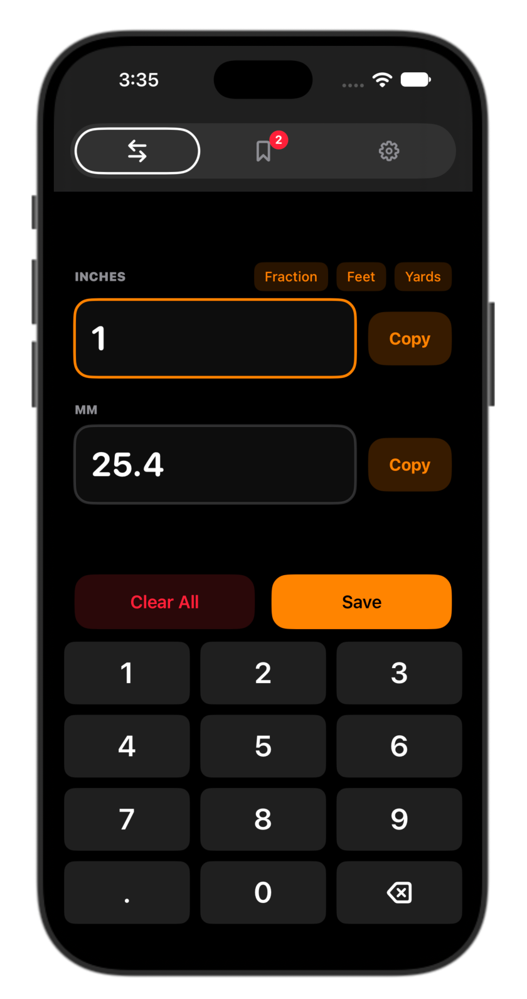

# VasherMade Converter

A fast, no-nonsense inches ↔ millimeters converter for iPhone and iPad.

<p align="center">
  
</p>

**Free and open source** under the [MIT License](LICENSE). No ads, no accounts, no tracking. Your saved conversions stay on your device.

## What it does

Converter is built for the shop, the job site, or anywhere you're jumping between imperial and metric measurements.

- **Convert both ways:** type in the **Inches** box to get millimeters, or tap the **MM** box and type to get inches. Results update as you type, with up to 8 decimal places.
- **Fractions, feet, and yards:** tap **Fraction**, **Feet**, or **Yards** to enter a measurement like `5/16`, `3 ft`, or `2 yd`. It's converted to inches and millimeters for you.
- **One-tap copy:** a **Copy** button next to each value puts it on the clipboard, ready to paste into another app.
- **Saved conversions:** tap **Save** to keep a conversion. The **Saved** tab (bookmark icon) lists them with the nearest fractional inch (to 1/64″). Swipe to delete one, or clear them all. They're kept between launches.
- **Common conversions:** the **Settings** tab (gear icon) has a quick-reference list of everyday sizes (1″, 3/4″, 1/2″, 1/4″, 1/8″, 1/16″).
- **Light, Dark, or System theme:** pick an appearance in **Settings**. The accent color is blue in light mode and orange in dark mode.
- **Big, easy keypad:** a built-in number pad with large keys and haptic feedback on every tap.

## Requirements

| What | Version |
| --- | --- |
| Mac | A Mac that can run the current version of Xcode |
| Xcode | 26.2 or later |
| iPhone / iPad | iOS / iPadOS 26.2 or later |
| Apple Account | A free Apple Account works. A paid Developer Program membership isn't needed. |

## Install it on your iPhone with a free Apple Account

You don't need to pay for the Apple Developer Program to put this app on your own phone. Apple lets anyone with a free Apple Account build and install apps on their own devices from Xcode. The steps below walk through the whole process, even if you've never used Xcode before.

### Step 1: Install Xcode

1. On your Mac, open the **App Store**.
2. Search for **Xcode** and click **Get** / **Install**. It's a large download (several GB), so this can take a while.
3. Open Xcode once it's installed. If it asks to install additional components, click **Install** and enter your Mac password.
4. If Xcode asks which platforms you want, make sure **iOS** is selected. That downloads what you need to build for iPhone.

### Step 2: Download the code

Choose **one** of these options:

**Option A: Download a ZIP (easiest)**

1. At the top of this GitHub page, click the green **Code** button.
2. Click **Download ZIP**.
3. Open your **Downloads** folder and double-click `VasherMade-Converter-main.zip` to unzip it.
4. Move the unzipped `VasherMade-Converter-main` folder somewhere you'll remember, like your **Documents** folder.

**Option B: Clone with Git**

Open **Terminal** and run:

```bash
git clone https://github.com/wesvasher/VasherMade-Converter.git
```

### Step 3: Open the project in Xcode

1. Open the folder you downloaded.
2. Double-click **`VasherMade-Converter.xcodeproj`**. Xcode opens the project.
3. If macOS warns that the project was downloaded from the internet, click **Open**.

### Step 4: Add your Apple Account to Xcode

1. In the menu bar, choose **Xcode → Settings…** (or press <kbd>⌘</kbd> <kbd>,</kbd>).
2. Click the **Accounts** tab.
3. Click the **+** button in the lower-left corner, choose **Apple Account**, and click **Continue**.
4. Sign in with your regular Apple Account (the same one you use for the App Store or iCloud).
5. Close the Settings window. Your account now shows up as a **Personal Team** in Xcode.

### Step 5: Set up code signing

Every iPhone app has to be "signed" by a developer before it will run. You'll sign it with your own Personal Team.

1. In Xcode's left sidebar (the Project navigator), click the blue **VasherMade-Converter** project icon at the very top.
2. In the middle panel, under **TARGETS**, select **VasherMade-Converter**.
3. Click the **Signing & Capabilities** tab.
4. Make sure **Automatically manage signing** is checked.
5. Click the **Team** dropdown and choose **Your Name (Personal Team)**.
6. Change the **Bundle Identifier** to something unique to you. Apple requires every app ID to be unique, and the one in the project is already taken. A good pattern is:

   ```
   com.yourname.Converter
   ```

   Replace `yourname` with your name or anything else unique, using only letters, numbers, hyphens, and periods.
7. Wait a moment. Xcode creates a signing certificate and provisioning profile for you. Once the red error messages under **Signing** go away, you're set.

> **Tip:** If you see *"Failed to register bundle identifier"*, the bundle identifier you picked is already in use. Change it to something more unique and try again.

### Step 6: Connect your iPhone

1. Plug your iPhone into your Mac with a USB cable.
2. Unlock your iPhone. If it asks **"Trust This Computer?"**, tap **Trust** and enter your iPhone passcode.
3. Turn on **Developer Mode** on your iPhone:
   1. Open **Settings → Privacy & Security**.
   2. Scroll to the bottom and tap **Developer Mode**. *(If you don't see it yet, finish Step 7 first: it appears after Xcode tries to install an app on the phone. Then come back here.)*
   3. Turn it on and tap **Restart**.
   4. After your iPhone restarts, unlock it and tap **Turn On** when asked to confirm, then enter your passcode.
4. In Xcode, the device list at the top center of the window (next to the ▶ Run button) shows your iPhone. Click it and select your iPhone from the list. It may take a minute the first time while Xcode prepares the device.

### Step 7: Build and run

1. Click the **▶ Run** button in the top-left of Xcode (or press <kbd>⌘</kbd> <kbd>R</kbd>).
2. Xcode builds the app and installs it on your iPhone.
3. The first time, the app won't open yet and Xcode may report that it couldn't launch because the developer isn't trusted. That's expected. Continue to Step 8.

### Step 8: Trust yourself as a developer on your iPhone

1. On your iPhone, open **Settings → General → VPN & Device Management**.
2. Under **Developer App**, tap your Apple Account email.
3. Tap **Trust "Apple Development: your email"**, then tap **Trust** again to confirm.
4. Go back to your Home Screen and tap **Converter** to open it. 🎉

You only need to do this once per Apple Account on each device.

### Good to know about free accounts

- **Apps expire after 7 days.** Apps installed with a free Personal Team stop opening after 7 days. To fix it, plug in your iPhone, open the project in Xcode, and press **▶ Run** again. Your saved conversions are kept.
- **Limit of 3 apps.** A free account can have up to 3 of your own apps installed on a device at a time.
- **Wireless installs.** After your iPhone has been paired over USB once, Xcode can usually install to it over Wi-Fi as long as the iPhone and Mac are on the same network. It shows up in the same device list.
- A paid [Apple Developer Program](https://developer.apple.com/programs/) membership extends signing to a year and allows App Store distribution. It isn't needed to use this app yourself.

## Try it without an iPhone

You can run the app in the iOS Simulator right on your Mac:

1. Open the project in Xcode (Steps 1–3 above).
2. In the device list at the top center of Xcode, choose any iPhone simulator, such as **iPhone 17**.
3. Press **▶ Run**. No Apple Account or signing changes are needed for the Simulator.

## Troubleshooting

| Problem | Fix |
| --- | --- |
| *"Signing for VasherMade-Converter requires a development team"* | Do Step 5: pick your Personal Team under **Signing & Capabilities**. |
| *"Failed to register bundle identifier"* | Change the **Bundle Identifier** to something more unique (Step 5.6). |
| *"The iPhone's iOS version is lower than the deployment target"* | Update your iPhone to iOS 26.2 or later in **Settings → General → Software Update**. |
| Your iPhone doesn't appear in Xcode | Unlock the phone, tap **Trust** when prompted, try a different cable or port, and make sure **Developer Mode** is on. |
| *"Untrusted Developer"* when opening the app | Do Step 8. |
| App stopped opening after a week | Expected with a free account. Reinstall from Xcode with **▶ Run**. |

## Contributing

Bug reports, ideas, and pull requests are welcome. Open an [issue](https://github.com/wesvasher/VasherMade-Converter/issues) or fork the repo and send a pull request.

## License

Released under the [MIT License](LICENSE). You're free to use, copy, modify, and share it.

---

Made by Wes Vasher · **VasherMade**
